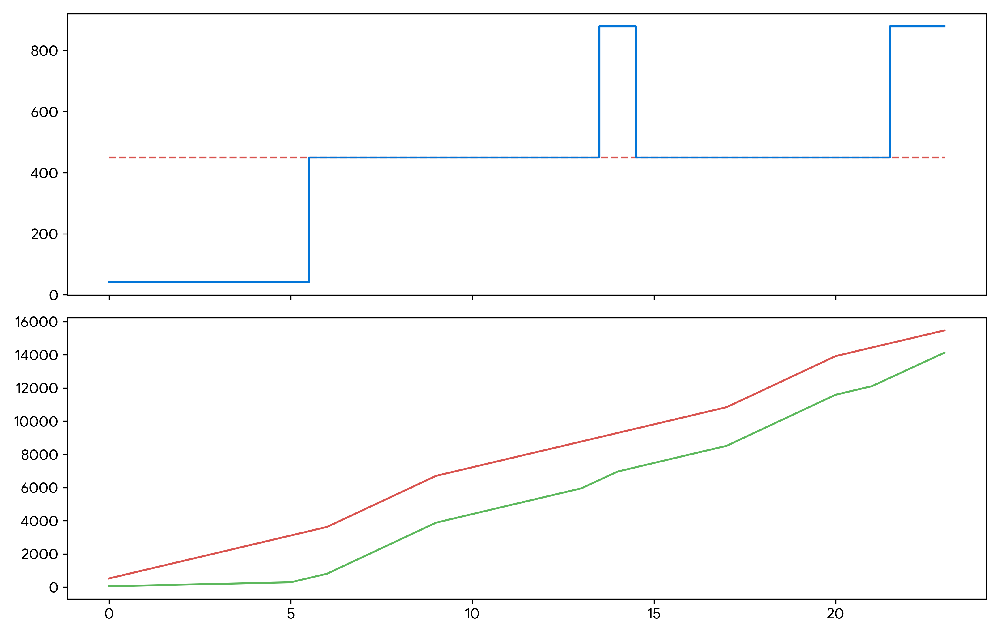

# Underground Mine Ventilation on Demand (VoD) Techno-Economic Optimization Engine

## Project Overview
This repository contains a quantitative, data-driven software framework that models the integration of smart automation hardware within underground mine ventilation infrastructures. The system leverages physical fluid dynamics constraints and statutory utility regulations to optimize energy consumption patterns, reducing operational volatility and maximizing capital efficiency.

This model is configured using the **Botswana Energy Regulatory Authority (BERA) 2026/27 Time-of-Use (TOU 8)** industrial electricity pricing schedule to analyze the real financial impact of transitioning from static auxiliary fan deployment to programmatic Automated Control.

## Core Problem Statement
Deep underground mines face immense cost centers, with auxiliary ventilation accounts frequently consuming up to **40-50%** of an active mine site's total electrical baseline. Traditional operations run massive mechanical fans at 100% continuous output regardless of immediate shaft occupancy or production cycles, creating massive financial waste.

## Technical Architecture & Methodology

### 1. Fluid Dynamics Engine (Fan Affinity Laws)
The script maps airflow requirements cubically to power consumption coefficients. The structural fan efficiency profile dictates that required power scales with the cube of the shaft velocity ratio:

$$\frac{P_2}{P_1} = \left(\frac{Q_2}{Q_1}\right)^3$$

By dynamically shifting airflow output to **45% of peak capacity** during low-occupancy shifts, the optimization script drops fan draw requirements to just **~9.1% of continuous baseline output**, creating significant operational cash-flow variances.

### 2. Commercial Optimization Layer
* **Statutory Framework:** Modeled after BERA TOU 8 tariff classifications, factoring in regular regional industrial rate increases.
* **Capital Budgeting Metrics:** Upfront automated engineering deployment costs are systematically evaluated using high-level quantitative project metrics:
  * **Net Present Value (NPV):** Project outlays discounted over a 5-year mining lifecyle using a 12% Cost of Capital.
  * **Payback Period Estimation:** Calculates exact capital recovery horizons based on real cash-flow margins.

## Performance Analysis & Visualizations
The model evaluates active mine shift profiles against peak and off-peak rate vectors, compiling detailed metrics shown below:

* **Baseline Traditional Opex:** BWP 15,471.00 / Day
* **Optimized VoD Opex Engine:** BWP 14,128.67 / Day
* **Net Annual Operational Cash Inflow:** ~BWP 454,950.56
* **Project Investment Payback Horizon:** ~17.1 Months
* **5-Year Asset Net Present Value (NPV @ 12%):** BWP 989,994.97



## Deployment & Replication Steps
To execute the economic simulation model locally, clone the repository and run the setup commands through your terminal:

```bash
git clone https://github.com
cd Pako-Aaron-Engineering
python vod_model.py
```

## Licensing & IP Statement
Copyright (c) 2026. All rights reserved. Licensed under the GNU General Public License v3.0 (GPL-3.0). Code artifacts and quantitative asset optimization models are open to public evaluation and review for academic, recruitment, and corporate validation purposes.
